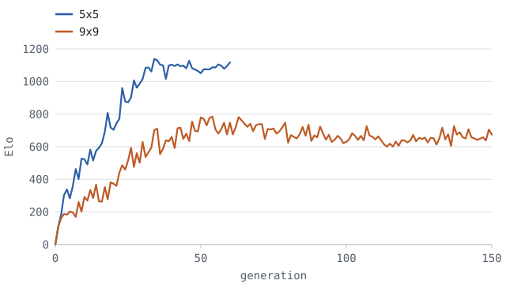
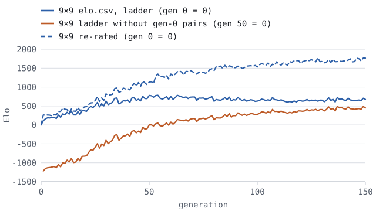

# AlphaZero Go

A from-scratch C++17 implementation of AlphaZero — self-play plus PUCT
Monte Carlo tree search guided by a residual neural network — for the game
of Go on boards from 5×5 to 19×19. It is a **teaching example**, the
successor to `alphazero-tictactoe`: every moving part (rules, convolutions,
backpropagation, search, self-play, training, evaluation) is written
directly, with no machine-learning library, and explained in
`docs/algorithm-explained.md`. It is not meant to be a strong Go engine.

Every number below comes from `docs/results/`, measured on one Apple M4
with 10 cores.

## Build

Requires CMake ≥ 3.16 and a C++17 compiler. The default build uses only the
C++ standard library:

```bash
cmake -S . -B build -DCMAKE_BUILD_TYPE=Release
cmake --build build -j
ctest --test-dir build --output-on-failure
```

Optionally, matrix multiplication can use BLAS (Apple Accelerate on macOS,
OpenBLAS elsewhere):

```bash
cmake -S . -B build-blas -DCMAKE_BUILD_TYPE=Release -DAZ_USE_BLAS=ON
cmake --build build-blas -j
ctest --test-dir build-blas --output-on-failure
```

Each build has 27 component tests plus an integration smoke test (28 in
ctest; `ctest -N | tail -1` prints `Total Tests: 28`). The smoke test
also runs `tools/gtp_match.py`, so it needs `python3` on the path.

**The presets in `configs/` say `backend = blas`**, because BLAS is 2.9×
faster on 5×5 and 18× faster on 19×19 (`docs/results/bench.txt`). Use them
with the `build-blas` binaries. On the default build, add
`--set backend=naive` to `train` (and pass `--backend naive` to `arena`,
`analyze` and `gtp`, which is their default); otherwise `train` stops with
`error: backend 'blas' not available: rebuild with -DAZ_USE_BLAS=ON`.

## Usage

Six programs are built next to the tests. Each prints its options with
`--help`. The sixth, `gtp`, plays other Go programs and is described in
Playing other programs via GTP below.

**`train`** runs the generation loop (self-play, training, checkpoint,
arena, commit). A new run copies the config into the run directory:

```
$ ./build-blas/train --config configs/5x5.cfg --run runs/5x5-seed1
starting runs/5x5-seed1 at generation 0; effective config (saved to runs/5x5-seed1/config.cfg):
...
gen 1 | selfplay 200 games avg 43.1 plies 6.5s | train loss p 2.85 v 0.49 lr 0.02 2.3s | arena elo 445.6 vs-prev 0.95 (distinct 19/20) 0.4s
...
gen 60 | selfplay 200 games avg 43.3 plies 7.7s | train loss p 1.73 v 0.09 lr 0.002 2.5s | arena elo 1117.5 vs-prev 0.50 (distinct 13/20) 2.0s
done: generation 60 in runs/5x5-seed1
```

These lines are from the reference runs, made before the arena chose its
opponents by rating. The arena part of the line now lists every opponent
with the new network's score, in the form `vs 149:0.55 120:0.70
ref1:0.40` (fixed players by name: `bot100` for a bot, `ref1` for a
reference network, see below), and adds `promoted` when the generation is
promoted into the reference set. `references.csv` in the run directory
lists the reference set with ratings, fixed players included.

`--set key=value` overrides any config key and `--generations N` trains
until generation N; the reference runs used, for example,
`--set seed=2` and `--generations 2`:

```
$ ./build-blas/train --config configs/5x5.cfg --run runs/5x5-seed2 --set seed=2
$ ./build-blas/train --config configs/19x19.cfg --run runs/19x19-check --generations 2
...
gen 2 | selfplay 20 games avg 364.5 plies 6630.8s | train loss p 5.68 v 0.26 lr 0.02 380.7s | arena elo 206.2 vs-prev 0.50 (distinct 10/10) 771.6s
done: generation 2 in runs/19x19-check
```

`--resume` continues a run from its `state.bin`, the commit point written
at the end of every generation, so a run interrupted at any moment resumes
exactly. Tunable keys may be changed on resume; architecture keys may not:

```
$ ./build-blas/train --run runs/5x5-seed1 --resume
resuming runs/5x5-seed1 at generation 60; effective config (saved to runs/5x5-seed1/config.cfg):
...
done: generation 60 in runs/5x5-seed1
$ ./build-blas/train --run runs/5x5-seed1 --resume --set blocks=4
error: cannot change architecture keys on resume: blocks
```

`bot_simulations` and `reference_networks` cannot change on resume
either: bot k is arena player −k and the reference networks come after
the bots, so both lists are fixed for the life of a run. `state.bin`
records them, so a hand-edited `config.cfg` is refused too, as is a
reference network file whose bytes changed.

`--rerate` trains nothing. It replays only the arena over a run's
existing checkpoints with the current opponent selection, and writes
`DIR/rerate/` (`results.csv`, `elo.csv`, `references.csv` and a `log.csv`
with one row per generation). `state.bin` and `config.cfg` are left
untouched, and `--set` applies to the replay only. A run made before
`arena_opponents` changed meaning should be re-rated with the presets'
new value:

```
$ ./build-blas/train --run runs/9x9-main --rerate --set arena_opponents=2
```

Before the first generation it prints one `rerate calibration` line per
fixed player (its score against generation 0 and its rating), for example
`rerate calibration | ref1 vs 0: 0.26 of 80 games, elo -176.8`. `--set`
may also change the fixed players for the replay, for example measuring a
run against a strong frozen network instead of its bot:

```
$ ./build-blas/train --run runs/9x9-sims200 --rerate --set bot_simulations= \
      --set reference_networks=runs/9x9-main/checkpoints/gen_0200.azn
```

**`arena`** plays two checkpoints against each other (or, with
`--b-bot SIMS` instead of `--b`, a checkpoint against a uniform bot
searching SIMS simulations per move), colors alternating, and prints the
score with a 95% Wilson interval
(`docs/results/9x9/final-arena.txt`). `--a-simulations N` and
`--b-simulations N` give one side its own search budget instead of
`--simulations`, so a frozen checkpoint can be a stronger reference by
searching more (`--b ckpt --b-simulations 3200`). `--random-symmetry`
searches with AlphaGo Zero's random symmetries (see Random symmetry in
search below); `--a-random-symmetry` or `--b-random-symmetry` does so for
one side only (not for a `--b-bot`, which gains nothing from it).
`--c-puct X` (default 1.5) and `--mcts-batch N` (default 8) set both
sides' search, and `--a-c-puct`, `--b-c-puct`, `--a-mcts-batch` and
`--b-mcts-batch` set one side's (see Tuning search settings in the arena
below). A side's label names any setting it does not share, and one
`Search:` line, printed before the match starts, names random symmetry
when either side uses it and both sides' `c_puct` and batch whenever one
differs from the defaults:

```
$ ./build-blas/arena --a runs/9x9-main/checkpoints/gen_0150.azn --b runs/9x9-main/checkpoints/gen_0000.azn --games 100 --simulations 200 --komi 7.5 --backend blas
A runs/9x9-main/checkpoints/gen_0150.azn vs B runs/9x9-main/checkpoints/gen_0000.azn: A scored 100/100 = 1.000 (95% CI 0.963-1.000), distinct games 97
A wins 100, B wins 0, draws 0
```

**`analyze`** plays a move list (GTP coordinates) or an SGF file, then
prints the board, the network's value and policy, and an MCTS search
(`docs/results/9x9/analyze-atari.txt`). For a checkpoint with an
ownership head (below) it also prints, after the value line, an
ownership map: who the network expects to own each point at the end, in
Black's terms, from +9 (surely Black's) to −9 (surely White's), with `.`
where it is unsure (|ownership| < 0.1). `--random-symmetry` does the same
for its search (the raw network lines always see the board as it is):

```
$ ./build-blas/analyze --checkpoint runs/9x9-main/checkpoints/gen_0150.azn --moves "D5 E5 F5 C3 E6 G3" --simulations 200 --komi 7.5 --backend blas
runs/9x9-main/checkpoints/gen_0150.azn: 6 moves played, Black to move, komi 7.5
...
Value (side to move): -0.01

Policy prior, % of legal moves ("." below 1%):
     A  B  C  D  E  F  G  H  J
...
 5   .  .  .  X  O  X  .  .  .
 4   .  .  3  3 51  8  5  .  .
 3   .  .  O  .  1  2  O  .  .
...
```

**`bench`** measures network throughput (inference at the search batch of
8 on one thread; a training step at batch 128) and the raw rules engine
(`docs/results/bench.txt`):

```
$ ./build-blas/bench
size   blocks x filters  backend       evals/s  train-step ms
5x5    3 x 32            naive           10544           28.0
5x5    3 x 32            blas            30488           12.1
...
19x19  10 x 128          blas              229         2393.5

size   random-playout moves/s
5x5                   1306178
...
```

### Growing a network

A trained network can be made deeper or wider without losing what it
learned. `grow` appends residual blocks that start as exact identities (a
zero-initialized second batch norm in each, see
`include/azgo/grow.hpp`), checks on 8 random positions that the grown
network's outputs match the original's within 1e-4, and saves it. Then a
new run starts from it, optionally seeded with the old run's replay
buffer. Growing 6 blocks to 10 on 9x9:

```
$ ./build-blas/grow --from runs/9x9-main/checkpoints/gen_0150.azn --blocks 10 --out runs/9x9-ten/start.azn
$ ./build-blas/train --config configs/9x9.cfg --run runs/9x9-ten --set blocks=10 \
      --set lr_schedule=0:0.002 --init-from runs/9x9-ten/start.azn --buffer-from runs/9x9-main
```

`grow --filters 96` widens instead (given `--blocks` too, it widens
first). Each new channel starts as a copy of an old one and every weight
that reads the old channel is split among the copies in random shares
that sum to it, so the outputs are unchanged while the copies receive
different gradients and grow apart. Width costs more than depth: compute
grows linearly with blocks but quadratically with filters, so 96 filters
cost about (96/64)² ≈ 2.25× as much as 64. Widening changes how many terms
each convolution adds up, so in float32 its outputs agree to about 1e-5
rather than bit for bit, hence the 1e-4 limit.

```
$ ./build-blas/grow --from runs/9x9-main/checkpoints/gen_0250.azn --filters 96 --out runs/9x9-wide/start.azn
```

`--init-from` makes the checkpoint generation 0 of the new run (its shape
must equal the config's, so pass `--set blocks=10` or `--set filters=96`);
`--buffer-from` loads the donor run's replay buffer, which must have the
same board size and history, and trims it to `buffer_positions`. The
optimizer's momentum starts at zero. `DIR/init.txt` records where the start came from and how
many positions and games the buffer held. Both options are for new runs
only: `--resume` refuses architecture changes, so growth always starts a
new run rather than continuing the old one. The new run's Elo is anchored
at its own generation 0 (the grown network), so its `elo.csv` is not on
the donor run's scale; compare the two runs with `arena` or by rating
them together.

The presets' learning-rate schedule restarts at 0.02, which is the rate
for a network that knows nothing; for a trained one it would wreck what
the network learned. Override it, for example `--set lr_schedule=0:0.002`
(the 9x9 preset's late-training rate).

### The ownership head

An optional third head predicts, for every point, who owns it when the
game ends: KataGo's auxiliary ownership target, explained in chapter 06
of the explainer. It is off in every preset. Two config keys control it:

- `ownership = true` adds the head. It is an architecture key, so it
  cannot change on resume.
- `ownership_weight` (0–10, default 1.5) weights the head's loss; 0 keeps
  the head but does not train it.

A run with the head shows its loss in the progress line
(`train loss p 2.42 v 0.36 o 0.590 lr 0.002`) and in the `log.csv`
column `ownership_loss`, which stays empty for a run without the
head. A run started before that column existed gets it, empty, on resume.

`grow --ownership` adds a randomly initialized head to a trained
checkpoint. The head changes neither the policy nor the value, so the
usual check of 8 random positions still applies, and it combines with
`--blocks` and `--filters`. A new run starts from the result like from
any grown network. Its donor buffer may come from a run made before
ownership existed: each game's final ownership is then recomputed by
replaying its moves.

```
$ ./build-blas/grow --from runs/9x9-wide96/checkpoints/gen_0050.azn --ownership --out runs/grown/wide96-g50-own.azn
old: 9x9, history 8, 6 blocks, 96 filters, value_hidden 64, 1032349 parameters
new: 9x9, history 8, 6 blocks, 96 filters, value_hidden 64, ownership head, 1032447 parameters
verified on 8 random positions (max difference 0); wrote runs/grown/wide96-g50-own.azn
$ ./build-blas/train --config configs/9x9.cfg --run runs/9x9-ownership --set filters=96 \
      --set ownership=true --set lr_schedule=0:0.002 --init-from runs/grown/wide96-g50-own.azn \
      --buffer-from runs/9x9-wide96
```

`--init-from` refuses a checkpoint whose head does not match the config,
and says how to fix it (`grow --ownership`, or `--set ownership=true`).

### Reference networks

The arena's fixed players are the ones a run never promotes or drops:
uniform bots (`bot_simulations`) and **reference networks**
(`reference_networks`), frozen checkpoints such as the best network of an
earlier run. A bot stops measuring anything early: in the 9×9 re-rate the
100-simulation bot scored at most 1 of 20 against every generation from 30
on and was never chosen after 43 (`docs/results/9x9/rerate/results.csv`),
so the presets set `bot_simulations =` (none) and carry a commented-out
`reference_networks` line instead. Leaving the key out of a config keeps
one 100-simulation bot, so a `config.cfg` written before the key existed
resumes as it did. For a 9×9 run with 96 filters, for example:

```
reference_networks = runs/9x9-main/checkpoints/gen_0200.azn, runs/9x9-sims400/checkpoints/gen_0050.azn
```

The first is a 6×64 network, widened to 96 filters to play in this run;
the second already has the run's shape.

- Paths are comma-separated and resolved from the directory `train` runs
  in (absolute paths are safest). Each file is read once per run.
- A reference network smaller than the run's shape is fitted to it with
  `grow`'s operations: widened, deepened, and given an ownership head (or
  its head dropped), so its policy and value are unchanged (widening up to
  float rounding, about 1e-5). Board size, history and `value_hidden` must
  match, and a network with more blocks or filters than the run is
  refused; so is a missing or corrupt file, and a file with the same bytes
  as an earlier entry. Each error names the file.
- Fixed players come bots first: with B bots, reference network j is
  player −(B + j), named `ref1`, `ref2`, … in the progress lines. Like a
  bot it plays `calibration_games` against generation 0 when the run
  starts, and is then chosen by the same expected-score rule. It searches
  with `arena_simulations`.
- `references.csv` lists it with kind `network` (no simulation count), and
  `reference-networks.csv` maps each player ID to its file
  (`player,name,path`).
- `state.bin` (version 4 and later) records each path with a 64-bit hash of the
  file's bytes. `--resume` refuses a changed list or a changed file, and
  `--rerate` refuses a changed file when it keeps the run's list.

### Random symmetry in search

AlphaGo Zero evaluated each position in its search under a dihedral
transform chosen uniformly at random from the board's 8 rotations and
reflections, and mapped the policy back (Silver et al., "Mastering the
game of Go without human knowledge", Nature 2017, Methods, "Expand and
evaluate"). AlphaZero dropped this, since chess and shogi are not
symmetric. By default this project searches like AlphaZero, always on the
untransformed board; two config keys switch on AlphaGo Zero's version:

- `mcts_random_symmetry` (default `false`): self-play's search.
- `arena_random_symmetry` (default `false`): the arena's search, in the
  trainer's arena rounds and in `--rerate`, for network players only (a
  bot's equal priors are the same under every transform). The `arena`
  and `analyze` tools take `--random-symmetry` instead; `arena` also
  takes `--a-random-symmetry` and `--b-random-symmetry` for one side.

Each evaluated position draws one symmetry from the game's own `Rng`
(the root included), so a run stays reproducible from its seed and
independent of the worker count. Both keys are tunable: `--resume` and
`--rerate` may change them, but a re-rate with a different
`arena_random_symmetry` from the live run plays other games and no longer
reproduces its `results.csv`. Every preset leaves both off; `configs/9x9.cfg`
lists them commented out.

To measure what the symmetries are worth before turning a key on, play a
checkpoint against itself with them on one side only. Both sides have the
same network and the same budget, so A's score away from 0.5 is the
effect of the search change alone:

```
$ ./build-blas/arena --a runs/9x9-main/checkpoints/gen_0150.azn --b runs/9x9-main/checkpoints/gen_0150.azn --a-random-symmetry --games 200 --simulations 200 --backend blas
```

That example keeps the default `--temperature-moves 4`. Random symmetry
changes the evaluations, not PUCT's exploration rule, so it should change
how widely each side's opening plies are sampled far less than the
settings below do.

### Tuning search settings in the arena

The same one-sided match tunes the search's other settings without a
training run: `c_puct`, the weight of the prior in PUCT, and `mcts_batch`,
the descents gathered into one network call. AlphaGo Zero evaluated
leaves in mini-batches of 8 (Silver et al. 2017, Methods, "Expand and
evaluate"), and here the batch changes the search, not just its speed:
each descent in a batch counts as a loss on its path (virtual loss)
until its leaf is evaluated, so the others spread out instead of
following it. A batch of 1 is plain sequential PUCT. Change one setting
on one side and play the checkpoint against itself; A's score away from
0.5 is that setting's effect at this checkpoint and budget.

Turn the opening temperature off for these matches. With
`--temperature-moves` above 0 the first plies are sampled from each
side's own visit counts, and the settings under test change how spread
out those counts are: a higher `c_puct`, or a batch of 8 whose virtual
loss pushes descents apart, samples more random opening moves, and is
penalised for that rather than for how it searches. With
`--temperature-moves 0` both sides play their most-visited move, and
`--random-symmetry` (on both sides, so it cancels out) keeps the games
apart instead; check the distinct games count in the score line. A batch
of 1 makes 8 times as many network calls per move, so its games are
slower.

```
$ ./build-blas/arena --a runs/9x9-main/checkpoints/gen_0250.azn --b runs/9x9-main/checkpoints/gen_0250.azn --a-c-puct 3 --temperature-moves 0 --random-symmetry --games 400 --simulations 200 --backend blas
Search: random symmetry per network evaluation; c_puct A 3, B 1.5; mcts batch 8
$ ./build-blas/arena --a runs/9x9-main/checkpoints/gen_0250.azn --b runs/9x9-main/checkpoints/gen_0250.azn --a-mcts-batch 1 --temperature-moves 0 --random-symmetry --games 400 --simulations 200 --backend blas
Search: random symmetry per network evaluation; c_puct 1.5; mcts batch A 1, B 8
```

The options take the train config's ranges, `c_puct` in (0, 100] and
`mcts_batch` in 1..256. A `--b-bot` searches with both too, so `--b-c-puct`
and `--b-mcts-batch` apply to it. A setting found this way makes the
arena's search stronger; whether self-play with it (the config keys
`c_puct` and `mcts_batch`) trains a stronger network takes a run.

### Resignation

AlphaGo Zero resigned clearly lost self-play games to save computation
(Silver et al. 2017, Methods, "Self-play"): the side to move resigns when
both its root value and its best child's value are below a threshold
v_resign, chosen automatically so that at most 5% of the games played
out with resignation disabled would have been resigned by their eventual
winner. It is off in every preset (`configs/9x9.cfg` lists the keys
commented out). Six tunable config keys control it:

- `resignation` (default `false`): self-play only; arena rounds,
  `--rerate` and the tools never resign.
- `resign_disabled_fraction` (0–1, default 0.1): the share of games
  played to the end with resignation disabled, to measure false positives.
  It must be above 0 when `resignation` is on.
- `resign_false_positive` (0–0.5, default 0.05): the largest
  false-positive rate v_resign may cause.
- `resign_threshold_initial` (−1–0, default −0.9): v_resign until
  enough disabled games exist.
- `resign_window` (default 500): how many of the most recent disabled
  games the calibration uses.
- `resign_min_games` (default 20, at most `resign_window`): disabled games
  needed before v_resign is calibrated.

How it works:

- After each search the side to move compares max(root value, Q of the
  most visited root child), from its own view (`Mcts::rootValue`,
  `Mcts::bestChildValue`), with v_resign. Black is never offered
  resignation at the empty board. A side that resigns loses; z follows
  from that as from any result, and the SGF says `RE[B+R]` or `RE[W+R]`.
- A disabled game records each side's record lows: the ply and value
  each time its value reached a new minimum. At threshold v it is a false
  positive exactly when the winner's value first drops below v before the
  loser's does (or the loser's never does). In that case resigning at v
  would have lost a won game. Nothing in the check draws from the `Rng`,
  so the game is the same up to that ply. A draw is never a false
  positive.
- After each generation's self-play, v_resign becomes the largest
  threshold on the grid −1.00, −0.99, …, 0.00 whose false-positive rate
  over the last `resign_window` disabled games is within
  `resign_false_positive`.
- Generation g resigns at the threshold computed after generation g − 1,
  and each game draws "disabled?" once from its own `Rng`, so a run stays
  reproducible and independent of the worker count. With
  `resignation = false` nothing is drawn: runs play exactly the games
  they did before the feature existed.
- `state.bin` (version 5) keeps the window of disabled games and which
  buffered games resigned, so `--resume` continues exactly. Since the
  keys are tunable, resume recalibrates v_resign from the window with the
  current values; unchanged keys give the same threshold. A run with an
  older `state.bin` starts with an empty window.
- `log.csv` gains `resign_threshold` (the v_resign used), `resign_rate`
  (resigned games / games with resignation enabled) and
  `resign_false_positive` (the false-positive rate at that threshold over
  the window, this generation's disabled games included). They are empty
  without resignation, and an older run's `log.csv` gets them, empty, on
  resume. The progress line adds, for example, `resign -0.87 rate 0.62 fp 0.031`.
- `ownership = true` with `resignation = true` is refused: a resigned game
  has no final position to take the ownership target from. For the same
  reason, `--buffer-from` refuses to seed a run with the ownership head
  from a buffer that holds resigned games.

No reference run used resignation, so nothing here measures what it
saves.

### The validation loss

The training loss (`policy_loss`, `value_loss` in `log.csv`) is measured
on batches from the replay buffer, the data SGD is fitting, and each
position there is drawn several times (the replay ratio). A lower
training loss can mean better judgment or a closer fit to the buffer;
the training loss alone cannot tell them apart. Each generation's new
self-play games are a held-out set for free: the network has never
trained on them. With `validation_loss = true` (the default; tunable on
resume) each generation also measures:

- `val_policy_loss`, `val_value_loss`, `val_ownership_loss`: the loss of
  the network about to train (generation g − 1's, the one that played
  the games unless gating is on) on every position of generation g's
  self-play games, measured before those games join the buffer.
- `seen_policy_loss`, `seen_value_loss`, `seen_ownership_loss`: the same
  network on as many positions drawn uniformly from its training
  distribution, the buffer as it stood after generation g − 1. Training
  drew from that window at random symmetries, so some of these
  positions it saw several times and some rarely or never. Empty
  whenever the buffer is empty, as at generation 1 of a run started
  without `--buffer-from`.

Both use the training loss's terms: the policy cross-entropy against the
visit distribution π, (z − v)², and, with the ownership head, the
unweighted per-point squared error (like `ownership_loss`). Each position
is shown once, at the identity symmetry, with batch norm in inference
mode (running statistics, as search uses it). The ownership columns are
empty without the head; a measurement that is not a number is logged as
`nan`, not left empty. The progress line adds, for example,
`val p 2.41 v 0.37 seen p 2.36 v 0.31`. An older run's `log.csv` gets the
six columns, empty, on resume.

How to read them:

- Compare `val_*` with `seen_*` of the same row, not with the training
  loss. They measure one network the same way; the training loss uses
  batch statistics and random symmetries, and averages over a network
  that changes during the generation's steps.
- `seen` below `val` is how much better the network does on its
  training distribution than on new games. It mixes fitting with how
  much the fresh games differ from the older games in the window, so
  read it as a trend. A gap that keeps widening while `val` stops
  falling is overfitting the buffer. Both falling together is learning.
- `val` below `seen` is possible and not a fault. Without gating, the π
  targets of the fresh games come from this network's own search, which
  its policy agrees with more than with the searches of the older
  networks that made most of the buffer's targets.
- The policy loss cannot fall below the entropy of the targets (about
  1.99 nats on 9×9, `tools/buf.py`), so compare changes, not levels.
- In a run started from scratch, generation 1's `val` row measures the
  random generation-0 network, whose batch-norm running statistics are
  still their initial values, so its numbers are not comparable with
  later rows. With `--init-from` generation 0 is the given network
  instead. With `--buffer-from`, generation 1's `seen` row is measured
  on the donor's games, which generation 0 never trained on, so it is a
  held-out number too.

Nothing feeds back into the run. The pass draws from no generator of
self-play, training or the arena (the buffer sample has its own,
`deriveSeed(seed, g, kPhaseValidation)`), changes neither the network nor
the buffer, and does not depend on the worker count. Checkpoints,
`state.bin` and the ratings are byte-identical with it on or off. It is a
forward pass over about twice a generation's new positions: on 9×9
(6×96 network, BLAS), 69 inference batches of 256 took 8% of the time
of 200 training steps. Its time is counted in `train_s`.

### Playing other programs via GTP

Every rating above is measured against the run's own networks and the
uniform bot. `gtp` lets a checkpoint play an outside program instead: it
speaks the Go Text Protocol (GTP version 2), the plain-text protocol Go
programs, match controllers and board programs such as Sabaki use. It is
for evaluation only. Each `genmove` is an MCTS search at temperature 0
with no root noise, reusing the subtree from the previous move, as in the
arena after its opening moves; nothing is trained, and it never resigns.

```
$ ./build-blas/gtp --checkpoint runs/9x9-main/checkpoints/gen_0250.azn --backend blas
```

It reads commands on stdin and answers on stdout, which carries nothing
but GTP; a startup line, one line per `genmove` (the move, its visits and
the root value) and errors go to stderr. `--simulations` (default 200),
`--mcts-batch`, `--c-puct`, `--backend`, `--random-symmetry` and
`--seed` work as in `arena`; `--komi` (7.5) holds until the controller
sends `komi`. It knows `protocol_version`, `name`, `version`,
`known_command`, `list_commands`, `quit`, `boardsize`, `clear_board`,
`komi`, `play`, `genmove`, `undo`, `showboard` and `final_score`. Vertices
are GTP's (columns skip I) in either case, and command names are
case-sensitive, as the protocol says. The rules are the project's: a
network plays only the board size it was trained for (`boardsize 19` to
a 9×9 checkpoint answers `? unacceptable size`), suicide is illegal,
positional superko is enforced (`? illegal move`), and `final_score` is
the Tromp-Taylor area score minus komi, every stone on the board
counting, in the form `B+3.5`. A well-formed vertex off the board
(`K5` on 9×9) is `? illegal move`; text that is no vertex (`I5`, `A0`) is
`? syntax error`. The engine sets no move cap of its own: the controller
decides when a game ends. It does not continue play after two passes in
a row: the game is over, `play` answers `? illegal move` and `genmove`
`? game is over`, and nothing is recorded, so a controller should stop
there (and ask for `final_score`) or send `clear_board`. In Sabaki this
means a game cannot be played on after both sides pass. GTP allows two
moves of one color in a row; the engine records the side to move as
passing in between. Right after a pass that inserted pass would be the
second one and end the game, so such a move is refused the same way
(`? illegal move` for `play`, `? game is over` for `genmove`).

`tools/gtp_match.py` (standard-library Python) plays a match between any
two GTP engine command lines, `--a` and `--b`, colors alternating (A is
Black in odd-numbered games). For GNU Go:

```
$ python3 tools/gtp_match.py \
      --a "./build-blas/gtp --checkpoint runs/9x9-main/checkpoints/gen_0250.azn --backend blas --random-symmetry" \
      --b "gnugo --mode gtp --boardsize 9 --komi 7.5 --chinese-rules --capture-all-dead --positional-superko" \
      --games 40 --size 9 --komi 7.5 --out runs/gnugo-gen250
```

A game ends after two passes in a row, after `--max-moves` moves
(default 2 × size², the project's cap) or on a resignation. It is scored
by `--scorer`'s `final_score`, A's by default, so put our engine in A: GNU
Go counts Japanese-style territory by default and, even with
`--chinese-rules`, removes the stones it judges dead, while our engine
and its training count Tromp-Taylor. The other engine's `final_score` is
recorded too, and the summary counts games where it names a different
winner. A move the other engine refuses (a ko retake that one program's
ko rule allows and the other's forbids) loses the game for the side that
played it, recorded as a forfeit. An engine that takes longer than
`--timeout` seconds (default 600; 0 for no limit) to answer one command is
taken to be hung: the match stops with an error naming it and the
command, keeping the games already finished. `--out` gets an SGF per game
(with `RU[Tromp-Taylor]` only when our engine is the scorer), a
`results.csv` row per game and each engine's stderr. The summary prints
A's score with a 95% Wilson interval, the Elo difference A − B it implies
(400 · log10(p / (1 − p)), the interval's ends converted the same way)
and the number of distinct games: two engines that both play
deterministically repeat the same two games, so give our engine
`--random-symmetry` (and GNU Go a different seed per run, if needed) to
make games differ.

The GNU Go flags are from GNU Go 3.8's documentation and not tested here;
check them with `gnugo --help` on your version. `--mode gtp` selects the
protocol; `--chinese-rules` selects area scoring; `--capture-all-dead`
makes it capture dead stones before passing, so a Tromp-Taylor count
agrees with its own judgment; `--positional-superko` selects our ko rule
(its default is simple ko); `--level` (0 to 10, default 10) sets its
strength. To play the network yourself, add `gtp` as an engine in a GTP
board program such as Sabaki, with arguments like
`--checkpoint runs/9x9-main/checkpoints/gen_0250.azn --backend blas`, and
start a game on the checkpoint's board size.

No match against GNU Go has been played for `docs/results/` yet.

## Presets

`configs/5x5.cfg`, `configs/9x9.cfg` and `configs/19x19.cfg`; the comments
in each file give the measurements behind the values. Time per generation
is self-play + training + arena from the runs' `log.csv`
(`docs/results/README.md` has the full table of keys).

| board | komi | blocks × filters | simulations | games per generation | measured time per generation |
|---|---|---|---|---|---|
| 5×5 | 24.5 | 3 × 32 | 200 | 200 | 11.3 s on average; 60 generations in 11.4 min wall time |
| 9×9 | 7.5 | 6 × 64 | 200 | 100 | 4.1 min on average (2.7 to 4.8); 150 generations in 10 h 10 min |
| 19×19 | 7.5 | 10 × 128 | 400 | 20 | 58.2 min for generation 1, 129.7 min for generation 2 |

No preset has a bot or a reference network (see Reference networks
above); the reference runs in `docs/results/` were made with one
100-simulation bot or none.

5×5 uses komi 24.5 because 5×5 Go is solved as a Black win by the whole
board; at komi 7.5 Black wins almost every game and the arena stops
telling generations apart (`docs/results/pilots/`). Checkpoints do not store
komi, and `arena` and `analyze` default to 7.5, so evaluating 5×5 checkpoints
needs `--komi 24.5` (and `--backend blas` with the BLAS build).

## Results

From `docs/results/README.md`, which has the details and the sources.

- **5×5: criterion met in 2 of 2 runs.** Both final networks (seeds 1 and
  2) beat generation 0 in **100 of 100** games (95% interval
  0.963–1.000), and Elo rises clearly: the mean `log.csv` rating of the
  last 10 generations is +469.5 above the first 10 for seed 1 (+361.3 for
  seed 2). Both curves rise until generation 31–34 and then go flat, once
  the network plays 5×5's known perfect line (96.8% of the empty-board
  prior on the center point) and Black wins nearly every self-play game.
- **9×9: criterion not met — the eye check fails.** The final network
  beats generation 0 100/100 (0.963–1.000), and the atari check passes
  (the capture is the top-visited move, 63 of 200 visits). But in the eye
  check the one move that gives a Black group two eyes has a prior below
  1% and is not among the ten most visited moves, and the network rates
  the group's death as no worse than its life (later evidence from a fair
  comparison qualifies this; see the ownership-head bullet below). The `elo.csv` curve rises
  to 784.8 at generation 54 and then goes flat (674.5 at generation 150; a
  slope of only +0.41 Elo per generation over the last third), but that
  is an artifact of anchoring on generation 0: 100-game head-to-heads show
  steady improvement — generation 150 beats generation 50 **98/100**,
  generation 90 86/100, generation 100 76/100 and generation 120 67/100,
  and generation 90 beats generation 50 89/100. Refit without the games
  against generation 0, the curve rises to the end (+449 Elo from
  generation 50 to 150). Re-rated with rating-aware opponents (with
  `arena_opponents = 2`; `docs/results/9x9/rerate/elo.csv`), it rises
  with a slope of +2.83 Elo per generation over the last third, and
  generation 150 is +634 above generation 50, against the head-to-head's
  +676.
- **9×9 continued to 250 and grown to 10 blocks.** The 6-block run was
  continued to generation 250 (re-rated Elo 1728.3 at 150, 1799.5 at 250),
  then grown to 10 blocks and trained 50 more generations. The grown
  network beats the old generation 250 59/100 (0.492–0.681) and 61/100
  at generation 25, about +60 to +80 Elo, and still fails the eye check:
  capacity alone is not the bottleneck at this budget. See
  [the section](docs/results/README.md#9x9-continued-to-250-and-grown-to-10-blocks).
  A 6×96 widening of the same network scored 70/100 against the old 250
  (+147 Elo) but only 52/100 against the 10-block net, so width and depth
  are not separated (see
  [the section](docs/results/README.md#grown-to-696-wider-and-width-vs-depth)).
- **9×9, more simulations.** Doubling self-play simulations (400 vs 200)
  gave no measurable gain at generation 50 (52/100) for 1.66× the time, and
  the eye check still fails (see
  [the section](docs/results/README.md#more-simulations-in-self-play-400-vs-200)).
- **9×9, ownership head.** Training an ownership head alongside the 200-simulation
  run made no measurable difference against the same run without it (48/100 at
  generation 25, 55/100 at 50, interval 0.452–0.644) and the eye check still fails,
  but the head's maps show the network reads the group's life and death correctly,
  and a fair comparison suggests it skips B1 because it judges another move bigger
  (see [the section](docs/results/README.md#an-ownership-head-auxiliary-target)).
- **All post-250 runs against one reference (gen 200).** Re-rated against the
  same frozen gen-200 network, wide96, grow10, sims200, sims400 and ownership
  all gained a similar, modest amount in 50 generations, within about ±40 Elo
  noise. All of them took the same 10,000 SGD steps at learning rate 0.002,
  which fits that pattern (see [the section](docs/results/README.md#all-post-250-runs-against-one-reference-gen-200)).
- **9×9, more self-play games.** Doubling games per generation (200 vs 100)
  gave at best a small edge at equal generations (61/100 at generation 25,
  56/100 at 50, interval 0.462–0.653), not clearly real, for 1.59× the time.
  The run kept 200 training steps per generation, so its replay ratio fell
  from 5.8 to 2.9: it tested fresher data, not more learning, and does not
  show that data quantity is not the bottleneck. A run with 200 games and
  400 steps is queued (see [the section](docs/results/README.md#more-self-play-games-per-generation-200-vs-100)).
- **9×9, learning-rate restart.** Restarting the learning rate at 0.02 and
  stepping it down to 0.006 and 0.002, instead of a flat 0.002, put the run
  behind the control at generation 25 (36/100, interval 0.273–0.458) and
  level with it at 50 (49/100): no measurable gain at 100-game resolution
  (see [the section](docs/results/README.md#a-learning-rate-restart-002-to-0002)).
- **9×9, arena screens of AlphaGo Zero search settings.** Generation 250
  against itself, 400 games, one setting changed on one side. Random
  symmetry in search scored 0.557 at 200 simulations (interval
  0.509–0.605, about +40 Elo) and 0.585 at 800 (+60): stronger play,
  not yet shown to train better (a self-play run is in progress).
  `c_puct` 0.75 to 1.25 was within noise of the preset 1.5, while 2.0
  and 3.0 were clearly worse; a batch of 1 against 8 was +30 Elo, not
  significant, so the presets' `c_puct` and batch stay (see
  [the section](docs/results/README.md#arena-screens-of-alphago-zero-search-settings)).
- **19×19: criterion met (it runs).** Two generations complete with finite
  losses in 58.2 and 129.7 minutes, and both checkpoints load in
  `analyze`. Two generations say nothing about strength, and none is
  claimed.
- **The pass bug.** The first set of reference runs exposed a search
  blind spot: a game-ending pass reply with a tiny prior was never
  visited, so trained 9×9 networks passed into Tromp-Taylor losses and
  generation 0 won 938 of 3,000 arena games against them. After the fix
  it won 72 of 3,000. `docs/results/passbug/README.md` is the case study.





The first chart is the `elo.csv` refit of the 5×5 seed-1 and 9×9 runs,
both anchored on generation 0 = 0. The second shows why the 9×9 curve
flattens: refit without the pairs against generation 0 (anchored so
generation 50 = 0), the same table rises to the end; so does the dashed
curve, the run re-rated with rating-aware opponents. The charts are drawn
by `tools/plot_elo.py` (standard-library Python):

```bash
python3 tools/plot_elo.py docs/results/5x5/elo.csv docs/results/9x9/elo.csv > docs/results/elo.svg
python3 tools/plot_elo.py "9×9 elo.csv, ladder (gen 0 = 0)=docs/results/9x9/elo.csv" \
    "9×9 ladder without gen-0 pairs (gen 50 = 0)=docs/results/9x9/elo-without-gen0.csv" \
    "9×9 re-rated (gen 0 = 0)=docs/results/9x9/rerate/elo.csv" > docs/results/elo-9x9.svg
python3 tools/plot_elo.py "5×5 seed 1=docs/results/5x5/elo.csv" "5×5 seed 2=docs/results/5x5-seed2/elo.csv" > docs/results/elo-5x5.svg
python3 tools/plot_elo.py "9×9 before the pass fix=docs/results/passbug/9x9-main/elo.csv" \
    "9×9 after the fix=docs/results/9x9/elo.csv" > docs/results/elo-passbug.svg
```

## Learn how it works

- [`docs/algorithm-explained.md`](docs/algorithm-explained.md) — the
  explainer: every idea, chapter by chapter in the order the code runs,
  quoted against the real source, with the measured results.
- [`docs/algorithm-explained.html`](docs/algorithm-explained.html) — the
  same text, illustrated: board, ko, im2col, network, search and
  training-loop diagrams, and the Elo charts. Open it in a browser; it
  follows the system's light or dark theme.
- [`docs/results/README.md`](docs/results/README.md) — every measured
  number and the verdict for each board size.
- [`docs/results/passbug/README.md`](docs/results/passbug/README.md) — the
  pass blind spot: symptom, diagnosis, fix, before and after.
- [`docs/superpowers/specs/2026-09-29-alphazero-go-design.md`](docs/superpowers/specs/2026-09-29-alphazero-go-design.md)
  — the design spec.
- [`docs/superpowers/plans/2026-09-29-alphazero-go.md`](docs/superpowers/plans/2026-09-29-alphazero-go.md)
  — the implementation plan.
- [`docs/superpowers/specs/2026-10-01-rating-aware-arena-design.md`](docs/superpowers/specs/2026-10-01-rating-aware-arena-design.md)
  and [`docs/superpowers/plans/2026-10-01-rating-aware-arena.md`](docs/superpowers/plans/2026-10-01-rating-aware-arena.md)
  — the rating-aware arena: opponents chosen by rating, the uniform bot and `--rerate`.
- [`docs/superpowers/specs/2026-10-03-ownership-head-design.md`](docs/superpowers/specs/2026-10-03-ownership-head-design.md)
  and [`docs/superpowers/plans/2026-10-03-ownership-head.md`](docs/superpowers/plans/2026-10-03-ownership-head.md)
  — the ownership head: an auxiliary per-point target, `grow --ownership` and the analyze map.
- [`docs/superpowers/specs/2026-10-04-resignation-design.md`](docs/superpowers/specs/2026-10-04-resignation-design.md)
  — resignation in self-play, with AlphaGo Zero's false-positive calibration.
- [`docs/superpowers/specs/2026-10-05-validation-loss-design.md`](docs/superpowers/specs/2026-10-05-validation-loss-design.md)
  — the validation loss: the network scored on each generation's fresh games before it trains on them.

`python3 tools/check_citations.py` checks that every `file:line` citation
in both explainers still points at the quoted definition.

## Extending to the GPU

A `MetalBackend` would implement the `Backend` interface (gemm, im2col,
col2im) with Metal compute kernels, so training steps benefit first. A
batching `Evaluator` would then gather leaves from all worker threads into
batches of 64–256 for the GPU, leaving MCTS unchanged. On Apple Silicon the
BLAS backend already runs on the CPU's matrix units, and the spec estimates
the M4 GPU's additional gain at roughly 2× and only at large batch sizes,
which is why v1 stops at the CPU.

## Authorship

Written by Mark Castelluccio. Designed and implemented with the assistance of
Claude (Anthropic), an AI assistant; commits carry a Co-Authored-By trailer.
